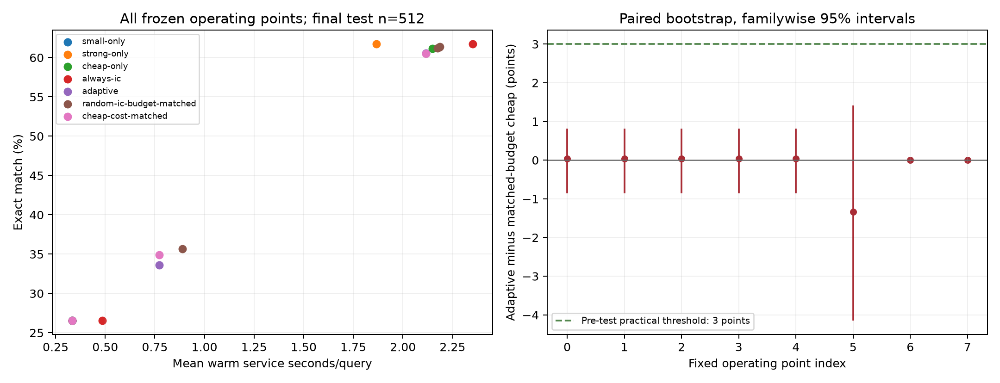
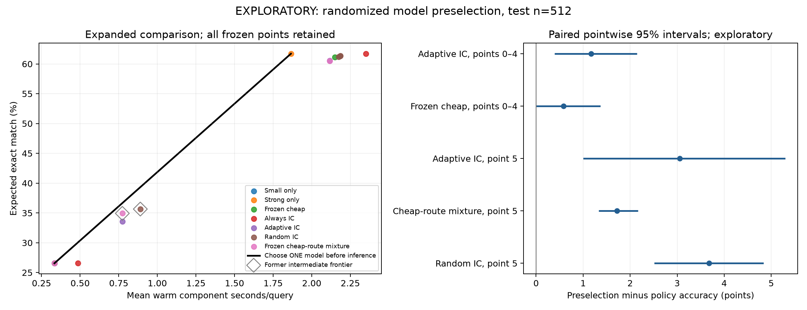

# COMP4901B — Adaptive Confidence Acquisition for Cost-Aware LLM Routing

**Group review · 24 October 2026 · Experiments complete**

**Finding:** Adaptive IC did not meaningfully outperform cost-matched cheap
routing under the frozen protocol. Separately, post-test exploration found that
randomized model preselection dominates the tested cascades in observed means.

## Research question and architecture

Does acquiring expensive confidence only for ambiguous decisions improve a
**Qwen2.5-1.5B-Instruct → Qwen2.5-14B-Instruct** cascade?

Generate the small answer → extract its ordinary QA prefill representation →
score a logistic correctness probe. Clear scores accept or escalate; scores with
`abs(cheap_score − threshold) < width` acquire IC, whose threshold decides
whether to retain the small answer or generate a strong answer.

Baselines: **small-only, strong-only, cheap-probe-only, always-IC and random-IC**.
Cascades always pay small QA first; always-IC omits the unused probe. Random IC
averages 20 seeded schedules matching expected **IC seconds**, not total cost;
its fractional boundary and cached timings make it a retrospective control.

## Methodology fixed before final-test inference

Closed-book TriviaQA `rc.nocontext`: pinned revisions, seeded buffered sampling,
and exclusions by ID and normalized question.

| Split | Questions | Official source | Use |
|---|---:|---|---|
| Training | 1,024 | Train | Fit scaler/probe weights |
| Calibration | 128 | Train | Select regularization and routing thresholds/widths |
| Assessment | 128 | Train | Viability and fixed-policy readout; no tuning |
| Final test | 512 | Validation | Frozen evaluation; later reused only for labeled exploration |

The prospective screen passed: on the **same 128 assessment questions**, small,
strong and the screen route scored 36.72%, 57.03% and 48.44%, with routing at
77.99% of strong-only cost. This was a viability gate, not proof of IC benefit.
Final policies were selected separately on calibration by
`accuracy − penalty × relative service time`, then frozen at eight penalties.

**Settings:** NF4 double-quantized 4-bit weights; FP32 compute/nonquantized
modules; eager attention; batch one; greedy first-nonempty-line/EOS stopping;
64-token cap. Primary metric: normalized exact match against supplied aliases.
Test cap hits: zero small, two strong.

**Confidence:** Train-only logistic probe (`C=.01`, calibration log loss) on
1,536-dimensional final normalized QA-prompt hidden states, without another
forward pass. IC uses a separate Yes/No prompt: authors' no-demonstration default,
last six prompt tokens, all 29 states, Gaussian alpha=1. Projection equivalence was
checked. This is a **transferred IC configuration**, not exact paper reproduction.

**Cost:** Synchronized warm timings, collected sequentially on GPU0 of Kaggle
T4×2, replay small QA + required probe + acquired IC + escalated strong QA.
Means: **.3336 s small, .000176 s probe, .1514 s IC, 1.8655 s strong**.
Single-model baselines pay only their own QA. Loads/warmups and offline collection
are separate; collecting all 1,536 component calls cost 1,203.42 service seconds.

## Frozen confirmatory findings

The primary comparator mixes the **two frozen cheap-route endpoints** using
cost-only weights. Exact matching and the practical cutoff were committed in a
transparent **pre-test addendum after development**; they were not in the earlier
policy artifact. No thresholds were tuned on final-test labels.

| Penalties | Adaptive EM | Matched cheap EM | Both: s/query | Difference, points [familywise 95%] |
|---|---:|---:|---:|---:|
| 0, .025, .05, .1, .2 | 60.55% | 60.51% | 2.1161 | +.04 [−.86, +.82] |
| .4 | 33.59% | 34.93% | .7732 | −1.34 [−4.14, +1.42] |
| .8, 1.6; no IC | 26.56% | 26.56% | .3338 | 0 [0, 0] |

Intervals: 10,000 paired-query percentile resamples (seed 4901), recomputing
cost-matching weights, with Bonferroni adjustment across all eight points,
targeting nominal 95% familywise coverage. Support required **estimated gain
≥3 percentage points plus a lower bound above zero**, at an exact match with IC.
Neither gain is statistically positive or meets the practical rule. Both upper bounds exclude the three-point gain
under this bootstrap criterion; this does **not** establish exactly zero effect.

The two IC-using rules acquire on 4.49%/21.88% and escalate on 94.53%/19.53%.
IC adds 6.74/33.21 ms per query. Versus the same rules with IC disabled, routing
changes are 1 beneficial/3 harmful and 36 beneficial/0 harmful; others are neutral.

**Figure 1.** All frozen points; dashed line marks practical effect size, not
statistical significance. [Vector PDF](results/review_figures/confirmatory_accuracy_cost.pdf).

## Separate post-test exploration

Select strong with query-independent probability `p` **before generation**;
otherwise select small. Only one model runs:
`EM(%) = 26.5625 + 35.15625p`; `seconds = .333587 + 1.531904p`, `0 ≤ p ≤ 1`.

| Earlier policy, penalty .4 | Matched s/query | Earlier → preselection EM | Gain, points [pointwise 95%] |
|---|---:|---:|---:|
| Adaptive IC | .7732 | 33.59% → 36.65% | +3.06 [1.00, 5.30] |
| Cheap-route mixture | .7732 | 34.93% → 36.65% | +1.72 [1.33, 2.17] |
| Random IC | .8898 | 35.65% → 39.33% | +3.68 [2.51, 4.84] |

All **40 tested non-endpoint points** are dominated in observed expected means.
The former frontier's two intermediate points lose their status; the expanded
frontier is the model-mixture segment among compared families. Original records
remain unchanged. At high budgets, strong-only scores 61.72% at 1.8655 s versus
adaptive's 60.55% at 2.1161 s.

Exploratory intervals: 10,000 paired resamples (seed 4903), cost-only weights
recomputed, **pointwise without multiplicity correction**. Random-IC intervals
condition on saved schedules. Coin flips are integrated analytically: these
describe expectations, not one realized schedule or simultaneous statistical
dominance of all 40 points.

**Figure 2.** Diamonds identify former intermediate frontier points. Positive
differences favor preselection. [Vector PDF](results/review_figures/exploratory_accuracy_cost.pdf).

## Diagnosis, limitations and report implications

Final-test AUROCs are descriptive point estimates:

| Confidence | Predict small correctness | Low confidence predicts strong rescue among 376 small errors |
|---|---:|---:|
| Cheap probe | .757 | .392 |
| IC | .676 | .440 |

Correctness prediction does not directly estimate incremental escalation benefit
per cost. Strong rescues 187 errors and introduces seven, but low confidence often
targets questions still difficult for it. Low-budget adaptive escalation gains
.360 net correct answers per strong call versus .352 for independent choices,
while selected strong calls cost 2.080 s versus 1.865 s overall. That targeting
benefit does not cover first-model/IC overhead. This is a diagnostic association,
not a causal decomposition.

Scope: **one dataset/final model pair, 4-bit quantization, transferred IC and
512 test questions**. The final grid was coarser than the viability screen:
its successful cheap threshold .15 was not a final candidate. Conclusions concern
frozen policies, not optimized routing generally. Buffered sampling and the
bootstrap's query-independence assumption limit inference.

Costs are **additive warm service-time replay**, not measured deployment latency,
throughput or money; residency, loading, dispatch/RNG, queuing and communication
can change comparisons. Exploration reused the already-inspected test set.
The evidence supports neither universal IC failure, exact paper reproduction,
deployment speedups nor simultaneous statistical dominance of every policy.

For the report, retain the prospective negative finding and present the stronger
baseline/frontier as a separate post-test discovery. All reproducibility records
remain intact: [methods](results/qwen15_methods.json),
[pre-test protocol](results/confirmatory_protocol.json),
[confirmatory results](results/qwen15_confirmatory.json),
[provenance](results/qwen15_confirmatory_provenance.json),
[exploration](results/qwen15_exploratory_mixture.json), and
[offline reproduction commands](README.md).
No further GPU runs or model-pair searches are part of this completed study.
