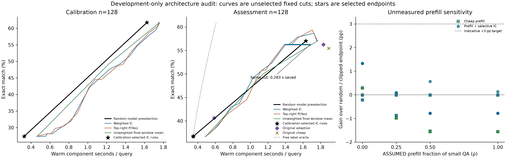

# Pre-generation IC: development-only architecture audit

9 November 2026. No new GPU inference. Original frozen evaluations, the consumed
original test and the reserved fresh test remain unchanged. This supplements
[the existing report](REPORT.md); it does not replace its confirmatory result.

## Architecture verification

**The cached IC is answer-independent and valid before generation.** Our
`estimate_ic(question)` constructs the authors' no-demonstration Yes/No prompt,
uses a separate transformer forward with `use_cache=False`, and generates zero
tokens. All 256 development IC records have one forward, zero output tokens,
and a valid 6×29 probability matrix. Reaggregation reproduces every stored score.
The ordinary QA and IC prompts differ. The original workflow unnecessarily
finished small-model QA before calling this estimator.

This agrees with [Chen et al., §3 and released implementation](https://arxiv.org/html/2506.09669v4)
([pinned source](https://github.com/tigerchen52/query_level_uncertainty/blob/5c15b32a6f9f36688098d0a749cb68bad11e9f23/ql_uncertainty/internal_confidence.py)).
The cheap probe also uses a **prompt-prefill** representation, despite originally
running after the answer. It could be deployed earlier, but obtaining that state
still requires small-model inference.

## Fair comparison and cost audit

We reused the original 128 calibration and 128 assessment questions, frozen
train-only probe, Qwen2.5-1.5B/14B pair and NF4/FP32 settings. New scalar cuts use
the same fixed .05 grid and eight existing cost penalties. Calibration alone
maximizes accuracy minus relative total service cost. Original adaptive/cheap
rules remain unchanged; same-grid answer-first controls separate retuning from
architecture. The analysis rules were committed at `35cdebd` before replay.
A later ID-key repair did not change the rules or calibration selections.

Let S/T be measured complete small/strong QA times, I the separate IC forward,
P the CPU probe, a strong-model choice, b IC acquisition, and F ordinary QA
prefill plus feature extraction. Costs are per-query warm component replay:

| Architecture | Cost |
|---|---|
| Original answer-first adaptive | S + P + bI + aT |
| IC-first | I + (1−a)S + aT |
| Same-rule answer-first IC-only | S + I + aT |
| Cheap-prefill, retained QA cache | F + P + bI + (1−a)D + aT, with S≈F+D |

IC-first saves exactly aS relative to **the same IC-only routing decisions**.
It cannot simply remove S from the original adaptive method, which needs its QA
prefill features. For cheap-prefill sensitivity we explicitly use
S + P + bI + a(T−S+F), assuming perfect continuation and no extra dispatch cost.
Those are hypothetical scenarios, not measured deployment costs or empirical
latency bounds. We show F=ρS for ρ=0/.25/.5/1 without estimating ρ from output
length or equating the distinct IC prompt's runtime with QA prefill.

QA KV can be reused only when retaining the **same model's exact QA prefix**,
cache, attention/position state and last-token logits across the decision. A
separate IC call needs its own prompt computation; it cannot supply QA KV.
Caches cannot transfer between the 1.5B and 14B models. Our stored JSON contains
neither KV nor prefill/decoding timestamps. A real paused-prefill implementation
also needs to verify that IC interposition preserves the eventual QA answer.

Assessment means: S=.3485 s, T=1.6322 s, I=.1335 s, P=.000473 s.
Top-right and unweighted alternatives use the **same measured I**, including
matrix extraction/aggregation overhead. No unmeasured speedup is credited for
simpler arithmetic. They reconstruct binary Yes-vs-No probabilities, not full
vocabulary P(Yes). The mean covers only the saved final six tokens and 29 states.
Static cuts outside [0,1] bypass the unnecessary estimator and become direct
small/strong baselines. Interior cuts pay I even if observed choices are constant.
All costs exclude deployment loading/queueing/communication and residency effects.

## Results

**Calibration selects direct small-only or strong-only at every penalty for all
three IC signals.** Every interior cut either loses to cost-matched random
preselection on calibration or costs more than strong-only without improving
accuracy. Consequently the selected IC families acquire IC 0% of the time.
Cost-only mixtures of their selected endpoints equal random preselection:

| Matched s/query | Random / selected IC families EM | Original adaptive EM | Original cheap EM |
|---:|---:|---:|---:|
| .6694 | 41.80% | 41.92% | 41.79% |
| .9904 | 46.88% | 46.96% | 46.87% |
| 1.3113 | 51.95% | 51.99% | 51.95% |

These comparisons use nearest **cost** brackets among calibration-fixed rules
plus direct endpoints. Assessment accuracy never chooses the brackets. Equality
with random is an algebraic identity of the selected endpoint policies; zero-width
difference intervals do not establish equal usefulness of the underlying signals.

To expose actual IC behavior rather than hide it behind endpoint selection, the
figure also shows **all unselected cuts from the fixed grid**. At the illustrative
cut .5, weighted IC-first obtains 56.25% at 1.3990 s versus 1.6819 s answer-first:
**.2828 s/query (16.8%) less service cost, identical answers**. This is a material
same-rule architectural saving, not a deployment measurement or selected method.

| Unselected .5 cut | Assessment EM | s/query | Gain vs matched random, pp [pointwise 95%] | Calibration gain, pp | Strong choice |
|---|---:|---:|---:|---:|---:|
| Weighted IC | 56.25% | 1.3990 | +2.91 [−1.47, +7.12] | −5.28 | 77.34% |
| Top-right P(Yes) | 50.78% | 1.1282 | +1.72 [−2.88, +6.25] | −4.78 | 53.91% |
| Unweighted mean | 50.00% | 1.1435 | +.70 [−4.08, +5.25] | −1.85 | 54.69% |

The .5 example was highlighted after replay. Its intervals are unadjusted,
and it is not a prespecified primary comparison or a selected operating point.
All three illustrative cuts acquire IC on every query. Weighted .5 rescues 27
small errors, harms two correct answers, avoids three strong-model harms and
misses four possible rescues. The positive assessment mean conflicts with
calibration and its interval includes zero. No cut is promoted after inspecting
assessment. In particular, the figure's higher assessment-only points are not
new operating-point selections or a rationale to use the reserved test.

Assessment correctness AUROC is **.789 cheap / .697 weighted / .683 top-right /
.745 unweighted**. Low confidence predicting rescue *among small errors* has
AUROC **.405 / .451 / .445 / .438**, respectively. These are distinct targets.
Weighted IC does not establish superiority to both simpler signals; its
correctness AUROC is below the unweighted mean, and all calibrated IC routing
families collapse to the same endpoints. AUROC contrasts and intervals are saved
as exploratory diagnostics, not tests of incremental routing benefit.

**Selective IC is not established as cost-effective before generation.** Across
four labeled prefill scenarios, the largest selected-policy assessment gain over
random is only **1.33 pp**, even at zero assumed prefill cost. Its high-budget
rule acquires IC on 10/128 questions and changes five decisions, all neutral in
correctness, relative to the same cheap cut without IC. Other scenario/rule
combinations make six beneficial, one harmful and eleven neutral changes, but
still fail to demonstrate a three-point cost-aware advantage. Comparisons between
differently tuned cheap cuts must not be attributed solely to IC acquisition.
Actual prefill cost and continuation overhead remain unidentified.

Thin curves are all unselected fixed IC cuts. Stars are calibration-selected
direct endpoints. The assessment horizontal segment compares the same weighted
.5 cut before/after generation. The oracle is label-aware and unattainable.
The right panel uses **assumed**, not measured, prefill fractions; it is not a
latency experiment. All eight fixed points per family remain in the artifacts.

## Complementarity and interpretation

Of 128 assessment queries, **42 are correct for both models, 50 wrong for both,
31 rescued by strong and five harmed by strong**. Free label-aware selection
could reach 78/128 = **60.94%**, versus strong-only 57.03%. Its minimum cost at
that accuracy is .6123 s/query for preselection and .7039 s for answer-first,
assuming free perfect labels. This demonstrates targeting headroom, not an
achievable confidence result. Predicting small correctness alone fails to
reliably identify which errors strong can repair.

Answer-first overhead substantially worsens cost at identical IC decisions, but
it does **not by itself explain away the original negative adaptive-vs-cheap
contrast**, whose two policies both pay small QA. Original adaptive prefill
savings require F; removing its entire small QA would be invalid. The fixed
weighted .5 diagnostic improves on random only on assessment, not calibration.
A credible cross-split IC gain, superiority to simple P(Yes), and reliable
selective-prefill cost advantage are therefore absent. **Stop here; a fresh
confirmatory run is not justified by this development evidence.**

Chen et al.'s actual claims concern generation-free answerability and adaptive
inference. Their Figure 6b plots **fraction of larger-model calls**, not our
complete service-cost metric; their cascade is Phi/Llama, and factual labels use
ROUGE-L>.3 rather than our alias exact match. Their large uncertainty-runtime
speedups concern answer-level comparators, especially long answers, not free
random preselection. Our result neither reproduces nor refutes those settings.
[Paper §§4.1–4.4 and Figure 6](https://arxiv.org/pdf/2506.09669).

## Missing measurement and reproducibility

To identify cheap-prefill cost, the minimum useful follow-up is a **development
small-model timing job**, not new strong-model or test inference: instrument QA
tokenization/prefill + feature transfer, CPU probe, retained-KV/logit continuation,
and IC interposition separately on the 256 development questions. Compare split
and ordinary QA on the same warmed pinned T4 configuration, verifying cached
features and greedy answers match. A few warm repeats quantify timing variation;
record standalone and IC-interrupted continuation, peak memory, and all added
bookkeeping. For the currently selected scenario families, the union contains
70 development IC acquisitions, with ten questions ever continuing small QA
after IC. These are the held-KV/interruption cases beyond the 256 paired
ordinary/split-QA controls; no strong-model or test calls are needed. Only then can F/D and reuse overhead replace sensitivity assumptions.
This job was not launched because the existing evidence is unpromising.

Replay: `python -m aca.pregeneration --root outputs/kaggle-qwen15-v6/outputs/qwen15screen --out outputs/pregeneration-audit`,
then `python scripts/report_pregeneration_audit.py`. The latter reads fixed
results and produces diagnostics/figures without fitting or selecting policies.
Numerical summaries, calibration choices and protocol are in
`results/pregeneration_*.json`; per-query scores/decisions remain under the ignored
output directory. Uncertainty uses 10,000 paired query bootstrap samples, seed
4905. Unselected .5 intervals are **pointwise exploratory**. The saved selected
families additionally have Bonferroni-40 intervals and fixed-budget contrasts
Bonferroni-9 intervals, as separate comparison families. None incorporates
hardware uncertainty or renewed method-selection uncertainty on this reused
assessment cohort. Findings concern this fixed grid, model pair and 128-question
assessment; they do not rule out other IC configurations or routers, which were
out of scope.
