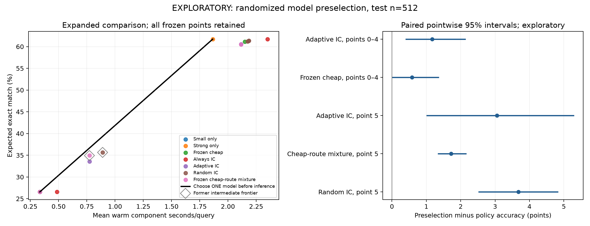
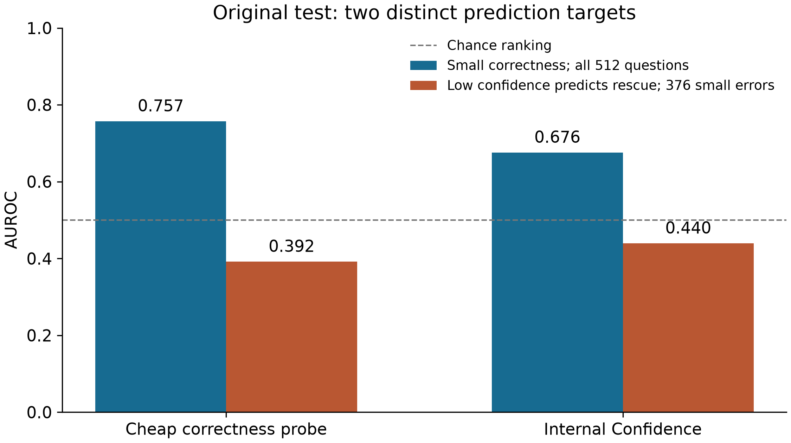
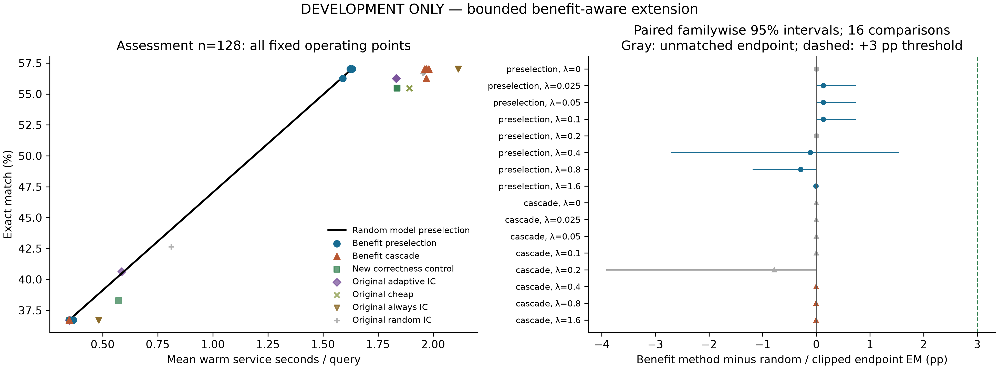

# Confidence acquisition and incremental-benefit routing for LLM inference

COMP4901B research draft · 27 October 2026 · Editable submission source

## Abstract

We study whether selectively acquiring an expensive Internal Confidence (IC)
estimate improves the accuracy–inference-cost trade-off of a small-to-strong
language-model cascade. On closed-book TriviaQA with Qwen2.5-1.5B-Instruct and
Qwen2.5-14B-Instruct, the frozen 512-question evaluation found no statistically
positive or practically meaningful adaptive-IC improvement over its cost-matched
cheap-routing control. The largest upper confidence bound among IC-using rules
was below the precommitted three-percentage-point practical threshold. A separate
post-test analysis found that choosing one model at random **before generation**
dominates the evaluated cascade points in observed expected accuracy and cost.
Correctness scores were discriminative, but did not identify sufficiently valuable
escalations to recover first-model and confidence-estimation costs. We therefore
implemented one bounded extension that directly predicts signed strong-minus-small
correctness benefit using either question text or ordinary small-model features.
Neither simple predictor passed its precommitted development gate. We stopped
without evaluating the reserved fresh test. The original confirmatory result
remains unchanged.

## 1. Question and contribution

The original hypothesis was that expensive confidence is most useful near a
cheap router's decision boundary. A logistic probe first estimates small-model
correctness; IC is acquired only when that estimate is ambiguous. A routing
decision then selects the cached small answer or calls the strong model.

The contribution is an empirical, cost-accounted evaluation and diagnosis of
this design, followed by a deliberately limited test of direct incremental-benefit
prediction. We do not claim to introduce learned model routing, relative-quality
prediction, or quality-minus-cost optimization. RouteLLM learns query-dependent
strong-versus-weak preferences [2], while a unified routing/cascading framework
already combines quality prediction with inference costs [3]. Our extension uses
paired exact-match differences and measured local inference times in this setup.

## 2. Data, models and separation

We use the question and answer aliases from TriviaQA `rc.nocontext`, without
retrieved passages [1]. Sampling uses a fixed revision, seeded buffered sampling,
and exclusions by question ID and normalized question text. These are project
subsamples, not the complete official benchmark.

| Partition | Questions | Official source | Permitted use |
|---|---:|---|---|
| Training | 1,024 | Train | Fit representations' preprocessing and predictors |
| Calibration | 128 | Train | Select regularization and policy thresholds |
| Assessment | 128 | Train | Development viability readout; no threshold fitting |
| Original final test | 512 | Validation | Frozen original study; later explicitly exploratory reuse |
| Reserved extension test | 512 | Previously unused validation | New confirmation only if the extension development gate passes |

The extension reuses training/calibration/assessment, which were already inspected
in the original study. Its development readout is therefore **not a fresh
confirmatory experiment**. The new test reservation excludes all 3,104 distinct
earlier project questions by ID and normalized text. The original 512 test labels
are not inputs to extension predictor fitting, regularization or threshold
selection, or a new confirmatory evaluation. Its post-test diagnosis motivated
the extension, which is why we reserved a new test.

The final model pair is **Qwen2.5-1.5B-Instruct → Qwen2.5-14B-Instruct**. Earlier
feasibility screens and access-driven model substitutions are retained in the
repository, but are not pooled into the final evaluation. The original pair's
prospective viability pass used the *same* 128 assessment questions: small-only
36.72%, strong-only 57.03%, and the screen's cheap route 48.44% at 77.99% of
strong-only service cost. Overall validation accuracies were not substituted.

Both models use NF4 double-quantized 4-bit weights, FP32 computation and
nonquantized modules, eager attention, batch size one, greedy decoding and
first-nonempty-line/EOS stopping with a 64-token cap. Inference runs sequentially
on GPU0 of Kaggle T4×2. The models are loaded separately; this is not a concurrent
two-model deployment benchmark. Pinned revisions are recorded with every run.
The cached development run recorded a 14B peak allocation of 13.46 GB
(12.54 GiB), with 13.59 GB reserved on a 15.64 GB T4. This establishes
compatibility for the pinned sequential configuration, rather than concurrent
residency of both models.

Correctness is normalized exact match against provided aliases; token F1 is saved
as a secondary descriptive metric. The original final test had zero small-model
and two strong-model token-cap hits. Earlier 32-token pilots are not the final
evaluation. This audit reduces truncation concerns but cannot exclude errors
from answer formatting, missing aliases, or a finite generation cap.

## 3. Original adaptive IC and baselines

The cheap probe is train-only standardization followed by logistic regression on
the 1,536-dimensional final normalized hidden state of the final ordinary-QA
prompt token. The state is captured during generation prefill without an extra
forward pass. Calibration selects `C=.01` by log loss. It is a prompt feature,
not a generated-answer representation.

For cheap score \(c_i\), boundary \(\tau\), and width \(w\), acquire IC when
\(|c_i-\tau|<w\). Otherwise retain the small answer when confidence is high and
escalate when it is low. Within the acquisition region, a separate IC threshold
determines the answer source.

IC follows Chen et al.'s released no-demonstration Yes/No prompting and
intermediate-state readout [4]. If \(p_{t,l}\) is the binary-softmax probability of
Yes at token position \(t\), state \(l\), then

\[
\operatorname{IC}(q)=\sum_{t,l}u_t v_l p_{t,l},\qquad
u_t\propto e^{-\alpha(t-(K-1))^2},\quad
v_l\propto e^{-\alpha(l-(L-1))^2}.
\]

We transfer the authors' Qwen setting: last six prompt tokens, all 29 states
including embedding and final normalized state, and \(\alpha=1\). Intermediate
states receive no added RMS normalization. Selecting only the Yes/No output-head
rows is algebraically equivalent to computing full logits and selecting them;
the numerical projection check had maximum error \(9.54\times10^{-7}\). This is a
**transferred configuration**, not a reproduction of the paper's model-specific
reported results.

Baselines are small-only, strong-only, cheap-probe-only, always-IC, and random-IC.
Always-IC omits an unused cheap probe. Random-IC averages 20 fixed seeded
schedules matched to adaptive IC's expected *IC seconds*, not total routing cost;
its fractional boundary and cached service times make it a retrospective control.

Calibration chooses policies at eight penalties
\(\lambda\in\{0,.025,.05,.1,.2,.4,.8,1.6\}\), maximizing accuracy minus relative
service cost. Policies and thresholds were committed before test inference.
The original cheap threshold grid was coarser than the viability grid and did not
include the screen's successful .15 threshold. Conclusions concern those frozen
policies, not an optimized correctness router generally.

## 4. Cost and inferential definitions

For query \(i\), let \(Y_{S,i},Y_{T,i}\in\{0,1\}\) denote small/strong exact-match
correctness; let \(s_i,t_i,k_i\) be synchronized warm QA and IC service times.
Let \(a_i\) mark escalation, \(b_i\) IC acquisition, and \(h_i\) required CPU
router time. Original adaptive cost is

\[
C_{A,i}=s_i+h_i+b_i k_i+a_i t_i,
\quad Y_{A,i}=(1-a_i)Y_{S,i}+a_iY_{T,i}.
\]

Single-model policies pay only their own QA cost. Small QA retains the measured
feature-capture overhead; we do not assume an unmeasured faster small-only path.
Loads, warmups and total offline data collection are reported separately.
Component replay is mathematically valid because each fixed query/model answer
and confidence estimate is independent of the policy choosing to use it.

The primary original control is a cost-only randomized mixture of **two frozen
cheap-routing endpoints**. This differs from the later model-preselection
baseline. Matching weights are recomputed in every paired bootstrap sample.
The matching procedure and three-point practical threshold were committed in a
transparent **pre-test addendum after development**, rather than in the earlier
policy-selection artifact.

Original uncertainty uses 10,000 paired-question percentile bootstrap resamples,
seed 4901, with Bonferroni adjustment over eight points for nominal 95% familywise
coverage. Support required an exact cost match, nonzero IC use, estimated gain
at least three percentage points, and a familywise lower bound above zero. This
is not the stricter requirement that the lower bound itself exceed three points.
Bootstrap intervals rely on question-level independence and a fixed trained
method; they do not capture training-seed or repeated-hardware uncertainty.

## 5. Frozen original confirmatory result

| Frozen penalties | Adaptive EM | Matched cheap EM | s/query | Gain, pp [familywise 95%] |
|---|---:|---:|---:|---:|
| 0, .025, .05, .1, .2 | 60.55% | 60.51% | 2.1161 | +0.04 [−0.86, +0.82] |
| .4 | 33.59% | 34.93% | .7732 | −1.34 [−4.14, +1.42] |
| .8, 1.6; no IC | 26.56% | 26.56% | .3338 | 0 [0, 0] |

Small-only is 136/512 (26.56%) at .3336 s/query; strong-only is 316/512 (61.72%)
at 1.8655 s/query. The strong model rescues 187 small-model errors and introduces
seven errors. Mean IC call time is .1514 s; mean probe time is .000176 s.
Offline collection of all 1,536 test component calls consumed 1,203.42 warm
service seconds, with 329.30 s of model-loading overhead separately recorded.

Neither IC-using rule meets the statistical or practical criterion. Their upper
bounds exclude a three-point gain under the frozen bootstrap rule. This supports
a negative result for these policies, not an assertion of exactly zero effect or
universal IC failure.

| Rule | IC acquisition | Escalation | IC overhead/query | IC changes versus no IC: beneficial / harmful / neutral |
|---|---:|---:|---:|---:|
| High budget, penalties 0–.2 | 4.49% | 94.53% | 6.74 ms | 1 / 3 / 3 |
| Penalty .4 | 21.88% | 19.53% | 33.21 ms | 36 / 0 / 64 |

The positive number of locally beneficial changes at penalty .4 does not imply
benefit over the cost-matched control: that comparator can buy more strong-model
answers with the same budget.

**Figure 1.** Frozen original-test policies and cost-matched cheap controls.
No operating point is selected from the test frontier.

## 6. Post-test exploratory model preselection

This analysis was requested **after inspecting the original final test** and used
no new GPU inference. Select the strong model independently with probability
\(p\) before generation; otherwise select small. The unselected model does not
run. Its expected curve is

\[
A(p)=\overline{Y_S}+p\overline{(Y_T-Y_S)},\qquad
C(p)=\bar s+p(\bar t-\bar s),\quad 0\le p\le1.
\]

On the original test, \(A(p)=.265625+.3515625p\) and
\(C(p)=.333587+1.531904p\) seconds. Model-choice coins are integrated analytically;
the curve does not describe a single realized random assignment.

| Earlier policy, penalty .4 | Cost s/query | Earlier → preselection EM | Preselection gain, pp [pointwise 95%] |
|---|---:|---:|---:|
| Adaptive IC | .7732 | 33.59% → 36.65% | +3.06 [1.00, 5.30] |
| Cheap-route mixture | .7732 | 34.93% → 36.65% | +1.72 [1.33, 2.17] |
| Random IC | .8898 | 35.65% → 39.33% | +3.68 [2.51, 4.84] |

The mixture dominates all 40 evaluated non-endpoint cascade/control points in
observed expected means. The original finite-point frontier's two intermediate
points lose frontier status when this baseline is added. Within the expanded
compared families, the mixture segment connects the efficient small-only and
strong-only endpoints. These descriptive statements are not simultaneous
statistical dominance claims over all policies or bounds on all possible routers.

Exploratory intervals use 10,000 paired resamples, seed 4903, recomputing cost
weights, with **pointwise 95% coverage and no multiplicity adjustment**. Random-IC
intervals condition on its saved expected schedules.

**Figure 2.** Post-test comparison of independent model preselection with the
earlier policies. The line integrates model-choice randomness analytically.

## 7. Why correctness prediction was insufficient

| Original-test diagnostic | Cheap probe | IC |
|---|---:|---:|
| AUROC for small-model correctness | .757 | .676 |
| AUROC for low confidence predicting strong rescue among 376 small errors | .392 | .440 |

These AUROCs have different targets and conditioning sets. Rescue AUROC among
small errors does not measure signed benefit over all questions, since it omits
harms on initially correct answers. It nevertheless shows that identifying small
errors did not reliably identify errors the strong model could repair.

At penalty .4, selected escalations produced .360 net correct answers per strong
call, only slightly above the global .352 gain per independent strong choice.
Those selected calls cost 2.080 s on average versus 1.865 s overall. This targeting
did not compensate for small-first execution and IC. These are diagnostic
associations, not a causal allocation of the failure into independent causes.

**Figure 3.** Original-test descriptive AUROC point estimates, with distinct
targets and conditioning sets. No confidence intervals are implied.

## 8. Final bounded extension: direct benefit prediction

Define signed incremental correctness benefit
\(\Delta_i=Y_{T,i}-Y_{S,i}\in\{-1,0,1\}\). This target rewards rescues and
penalizes harms directly. Two regularized linear approaches predict
\((\Delta_i,s_i,t_i)\):

1. **Query-only preselection:** train-only word TF–IDF (unigrams/bigrams,
   minimum document frequency two, at most 8,000 features, sublinear TF, L2
   normalization), then multioutput ridge regression. The predictor runs before
   either model and needs no neural encoder.
2. **Post-answer benefit cascade:** train-only standardization of the original
   1,536-dimensional QA prompt features, then the same ridge family. The decision
   occurs after the small answer, and pays its complete QA cost. Features remain
   prefill states; this does not introduce response-token representations.

Exactly four ridge penalties (1, 10, 100, 1,000) are considered per feature family.
Calibration benefit MSE chooses one, with ties favoring stronger regularization.
The same regularization fits all three outputs. Benefit is clipped to [−1,1];
time predictions are clipped below at .001 s. Per-query CPU transformation and
prediction overhead is measured after one excluded warmup.

For each of the eight fixed cost penalties, the score is predicted benefit minus
predicted incremental service cost: \(\hat\Delta-\lambda(\hat t-\hat s)/\bar
t_{train}\) for preselection, and \(\hat\Delta-\lambda\hat t/\bar t_{train}\)
for cascading. Calibration alone selects a threshold on the committed finite
grid. All 16 points are retained. Original IC/cheap policies remain unchanged;
a separate finer-grid correctness control uses the original probe and the same
calibration utility, addressing the original grid limitation fairly.

Only the missing **1,024 strong training predictions** are collected. Existing
small features and paired calibration/assessment outputs are reused. No model
pair, dataset, feature encoder, or IC configuration is changed.

The frozen development gate requires at least one of 16 points to have an exact
random-preselection cost match, at least eight assessment questions per branch,
calibration and assessment gains each ≥3 pp, and a positive Bonferroni-16
familywise 95% paired-bootstrap lower bound (10,000 resamples, seed 4904).
Otherwise the method stops and the reserved test remains unused. A pass permits
fresh confirmation only after committing the fitted predictors and thresholds.
Fresh-test methods cannot be changed after observing its results.

### Development outcome: STOP

The extension completed all **1,024 missing strong training answers**, then fit
and evaluated the two methods. This added 1,717.42 warm QA service seconds
(28.62 minutes), plus 308.57 s loading and 2.02 s warmup. Existing 1,280 small
records, 256 paired calibration/assessment records and 256 IC estimates were
verified unchanged. No additional small, IC or test inference ran. A packaging
error initially omitted cached hidden features from the CPU analysis; restoring
the lossless, explicitly aligned float32 arrays resolved it without new inference
or methodological changes. The complete archive and recovery provenance remain
available. Strong cap hits were 5/1,024 training, 1/128 calibration and 1/128
assessment; all small records remained below the cap.

Calibration selected ridge α=10 for query preselection and α=1,000 for the
hidden-state cascade. Assessment small-only was 47/128 (36.72%) at .3485 s/query;
strong-only was 73/128 (57.03%) at 1.6322 s/query, with 31 rescues and five harms.
Costs below use these matched assessment records, rather than original-test
means. Curves from different partitions/workers are not pooled.

| Fixed method / penalties | Assessment EM | s/query | Strong choice | Gain vs random, pp [familywise 95%] |
|---|---:|---:|---:|---:|
| Query preselection, .025/.05/.1 | 57.03% | 1.6241 | 99.22% | +.128 [0, +.720] |
| Query preselection, .4 | 56.25% | 1.5899 | 96.88% | −.113 [−2.704, +1.530] |
| Query preselection, .8 | 36.72% | .3669 | 1.56% | −.290 [−1.180, −.004] |
| Benefit cascade, 0–.2 | 56.25–57.03% | 1.9613–1.9809 | 98.44–100% | Above strong-only cost; no exact match |
| Benefit cascade, .4/.8/1.6 | 36.72% | .3488 | 0% | −.004 [−.006, −.001] |

All 16 points are in Appendix A. The first row is the largest observed matched
assessment gain, **not a selected new policy**. None of the fixed points routed
at least eight assessment questions to each branch. The largest calibration gain
was only 1.075 pp; the largest exactly matched assessment gain was .128 pp.
Thus no point passed the coverage, practical-effect and uncertainty requirements.
**The fixed outcome is STOP. The reserved 512-question test remains untouched;
there is no new confirmatory result.**

| Assessment diagnostic, descriptive | Query preselection | Benefit cascade |
|---|---:|---:|
| AUROC for positive signed benefit (rescue vs all other questions) | .478 | .561 |
| AUROC for rescue among small-model errors | .507 | .579 |
| Signed-benefit Spearman correlation | −.027 | .090 |
| Mean CPU router time | .489 ms | .229 ms |
| Strong service-time prediction RMSE | 1.078 s | 1.085 s |

These point estimates have no uncertainty intervals. The hidden features show
some rescue discrimination, but the frozen utility rules mostly select an
endpoint and do not overcome small-first cost. Cost prediction is also noisy.
This supports stopping this bounded linear extension; it does not establish that
all benefit-aware routing is ineffective.

All established baselines were replayed on the same assessment queries, including
the separate finer-grid correctness control. At λ=.4 that control reached 38.28%
at .5727 s/query, versus 40.63% at .5869 s for the original adaptive rule and
42.63% at .8120 s for its random-IC control. These are different budgets, so
accuracy alone does not rank them. The complete plot shows all fixed points and
the independent model-preselection curve. Random preselection dominates 13 of
the 16 new points in observed means. The three identical near-strong query
points sit .128 pp above the line, and the original adaptive λ=.4 point also
sits slightly above it on this development subset. Therefore the original test's
all-point descriptive dominance does **not** extend to every development point.
No new operating point or policy mixture is selected from this frontier.

**Figure 4.** Previously inspected assessment data, n=128. Left: all fixed new
points and baselines. Right: paired Bonferroni-16 percentile intervals from the
frozen evaluator. Gray points exceed strong-only cost and compare with its
clipped endpoint, not an exact cost match. The dashed line marks +3 pp. These
are development results, not fresh-test confirmation.

## 9. Break-even condition

For cascade decision \(a_i\), preselection decision \(q_i\), and router costs
\(h_{c,i},h_{q,i}\):

\[
A_c=E[Y_S]+E[a\Delta],\quad C_c=E[s]+E[h_c]+E[at],
\]
\[
A_q=E[Y_S]+E[q\Delta],\quad C_q=E[s]+E[h_q]+E[q(t-s)].
\]

For the same decisions \(a=q\), accuracy is identical and cascading costs an
additional \(E[as]+E[h_c-h_q]\). To justify small-first execution, the richer
features must improve targeting enough to pay this cost.

For an exactly matched independent preselection probability
\(p=(E[h_c]+E[at])/(E[t]-E[s])\in[0,1]\), cascading wins precisely when

\[
E[a\Delta] >
\frac{E[h_c]+E[at]}{E[t]-E[s]}E[\Delta].
\]

With constant costs \(s,t,h\), escalation rate \(r>0\), global mean benefit
\(g=E[\Delta]>0\), and selected benefit \(g_r=E[\Delta\mid a=1]\):

\[
\frac{g_r}{g}>\frac{t}{t-s}+\frac{h}{r(t-s)}.
\]

Using the original test's mean QA times illustratively gives a minimum targeting
lift of about 1.218 before router/IC overhead. This constant-cost illustration
does not replace the per-query measured-cost evaluation. Above strong-only cost,
the comparator is the clipped strong endpoint; we do not extrapolate a probability
above one or call it an exact match.

**Figure 5.** Algebraic illustration assuming constant QA costs, positive global
benefit and zero router overhead. The marked point uses original mean QA costs;
it is not an additional experiment or fitted threshold.

## 10. Limitations and interpretation

The original negative finding is specific to one final dataset/model pair,
4-bit quantization, a transferred IC setting, eight frozen points and a
512-question test. A small assessment set makes the extension gate conservative;
the observed failure to pass does not establish that incremental-benefit
prediction cannot work. Reused development data and a bounded linear family constrain claims.
Question sampling, imperfect lexical labels, potential pretraining exposure and
single-run measurements limit external validity.

Costs are **additive warm service-time replay**, not measured deployment latency,
throughput, energy or money. Residency, loading, queueing, dispatch, RNG,
communication and concurrency can change costs. Cached components and any new
training collection retain their run provenance. Training/data-collection expense
is distinct from amortized per-query routing cost. The post-test comparison is
explicitly exploratory on an already-used test set.

The evidence does not support universal IC failure, exact paper reproduction,
deployment speedups, a novel general routing algorithm, or simultaneous
statistical dominance of every policy. The defensible contribution is a preserved
negative confirmatory result, a stronger exploratory baseline, a target-mismatch
diagnosis, and a completed direct-benefit extension that stopped under its fixed
development rule. We recommend reporting these findings without further model
or architecture search.

## Appendix A. All fixed extension points

Previously inspected assessment data only. Gains use exact cost-matched
randomized model preselection when available, otherwise the clipped strong
endpoint. Endpoint comparisons cannot satisfy the gate's exact-match rule.
Intervals have nominal familywise 95% coverage under Bonferroni-16 paired
percentile bootstrap, conditional on fixed fitted models. Zero-width endpoint
intervals arise from identical observed answers and do not prove zero population
effect. Small negative intervals near zero reflect measured CPU overhead.

| Method | λ | Cal. gain, pp | Assessment EM (%) | s/query | Strong (%) | Exact cost match | Gain vs random, pp | Familywise 95%, pp | Gate pass |
|---|---:|---:|---:|---:|---:|---|---:|---|---|
| preselection | 0 | +0.000 | 57.03 | 1.6327 | 100.00 | No; endpoint | +0.000 | [+0.000, +0.000] | False |
| preselection | 0.025 | +0.000 | 57.03 | 1.6241 | 99.22 | Yes | +0.128 | [+0.000, +0.720] | False |
| preselection | 0.05 | +0.237 | 57.03 | 1.6241 | 99.22 | Yes | +0.128 | [+0.000, +0.720] | False |
| preselection | 0.1 | +0.237 | 57.03 | 1.6241 | 99.22 | Yes | +0.128 | [+0.000, +0.720] | False |
| preselection | 0.2 | +0.000 | 57.03 | 1.6327 | 100.00 | No; endpoint | +0.000 | [+0.000, +0.000] | False |
| preselection | 0.4 | +0.844 | 56.25 | 1.5899 | 96.88 | Yes | -0.113 | [-2.704, +1.530] | False |
| preselection | 0.8 | +1.075 | 36.72 | 0.3669 | 1.56 | Yes | -0.290 | [-1.180, -0.004] | False |
| preselection | 1.6 | -0.012 | 36.72 | 0.3490 | 0.00 | Yes | -0.008 | [-0.013, -0.003] | False |
| cascade | 0 | +0.000 | 57.03 | 1.9613 | 98.44 | No; endpoint | +0.000 | [+0.000, +0.000] | False |
| cascade | 0.025 | +0.000 | 57.03 | 1.9704 | 99.22 | No; endpoint | +0.000 | [+0.000, +0.000] | False |
| cascade | 0.05 | +0.000 | 57.03 | 1.9809 | 100.00 | No; endpoint | +0.000 | [+0.000, +0.000] | False |
| cascade | 0.1 | +0.000 | 57.03 | 1.9809 | 100.00 | No; endpoint | +0.000 | [+0.000, +0.000] | False |
| cascade | 0.2 | +0.000 | 56.25 | 1.9689 | 99.22 | No; endpoint | -0.781 | [-3.906, +0.000] | False |
| cascade | 0.4 | +0.484 | 36.72 | 0.3488 | 0.00 | Yes | -0.004 | [-0.006, -0.001] | False |
| cascade | 0.8 | +0.484 | 36.72 | 0.3488 | 0.00 | Yes | -0.004 | [-0.006, -0.001] | False |
| cascade | 1.6 | -0.008 | 36.72 | 0.3488 | 0.00 | Yes | -0.004 | [-0.006, -0.001] | False |

## Appendix B. Revisions and reproducibility records

| Component | Pinned revision |
|---|---|
| TriviaQA | `0f7faf33a3908546c6fd5b73a660e0f8ff173c2f` |
| Qwen2.5-1.5B-Instruct | `989aa7980e4cf806f80c7fef2b1adb7bc71aa306` |
| Qwen2.5-14B-Instruct | `cf98f3b3bbb457ad9e2bb7baf9a0125b6b88caa8` |

The [original frozen methods](../results/qwen15_methods.json),
[confirmatory protocol](../results/confirmatory_protocol.json),
[original result](../results/qwen15_confirmatory.json) and
[exploratory result](../results/qwen15_exploratory_mixture.json) remain unchanged.
The extension's [pre-inference protocol](../results/benefit_protocol.json),
[fitted predictors and thresholds](../results/benefit_methods.json),
[all development comparisons](../results/benefit_development.json),
[diagnostics](../results/benefit_diagnostics.json) and
[archive/recovery provenance](../results/benefit_provenance.json) are separate.
The [reproduction guide](REPRODUCIBILITY.md) identifies local raw archives and
commands. Analysis and figure regeneration need no new GPU inference.

## References

1. Joshi, M., Choi, E., Weld, D. S., & Zettlemoyer, L. (2017).
   *TriviaQA: A Large Scale Distantly Supervised Challenge Dataset for Reading
   Comprehension*. ACL, 1601–1611. [ACL Anthology](https://aclanthology.org/P17-1147/).
2. Ong, I., et al. (2025). *RouteLLM: Learning to Route LLMs with Preference Data*.
   ICLR 2025. [Paper](https://openreview.net/pdf?id=8sSqNntaMr),
   [arXiv v4](https://arxiv.org/html/2406.18665v4).
3. Dekoninck, J., Baader, M., & Vechev, M. (2026 version).
   *A Unified Approach to Routing and Cascading for LLMs*.
   [arXiv:2410.10347v4](https://arxiv.org/html/2410.10347v4).
4. Chen, L., de Melo, G., Suchanek, F., & Varoquaux, G. (2026 version).
   *Query-Level Uncertainty in Large Language Models*.
   [arXiv:2506.09669v4](https://arxiv.org/html/2506.09669v4),
   [implementation pinned at 5c15b32](https://github.com/tigerchen52/query_level_uncertainty/tree/5c15b32a6f9f36688098d0a749cb68bad11e9f23).

The course's final author list, required template, submission length and
presentation timing remain to be supplied; this source is intended for revision
into that format. Reproducibility records remain in the repository.
