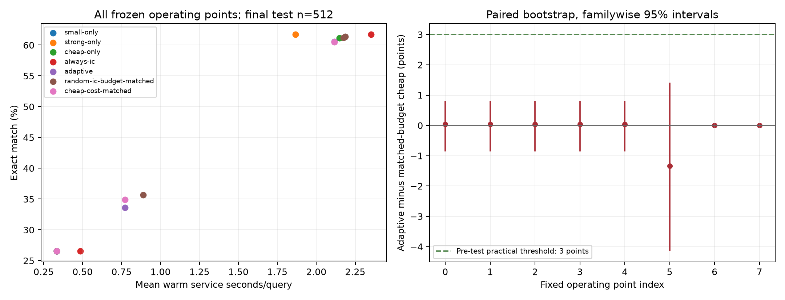
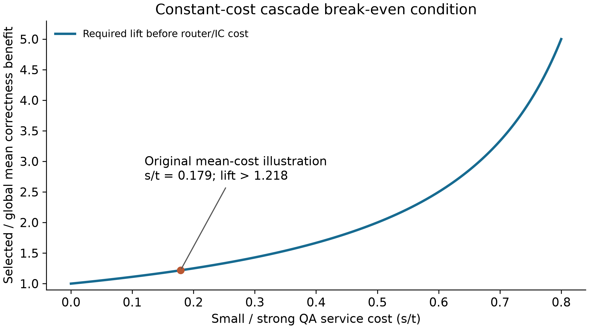
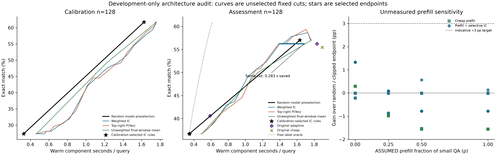

# Adaptive Confidence Acquisition for Cost-Aware LLM Routing

**COMP4901B research project · Consolidated manuscript · 9 November 2026**

**Course submission, 22 November 2026:** the shortened conference paper is the
[EMNLP/ACL-style PDF](COMP4901B_report.pdf), with [LaTeX source](REPORT.tex).
It has eight main-text pages, plus references and appendices. This Markdown file
retains the full consolidated evidence manuscript; frozen numerical records are
unchanged.

**Authors:** [complete author names and affiliations]

## Abstract

Can selectively acquiring an expensive confidence estimate improve a small-to-strong
language-model cascade? We evaluate adaptive Internal Confidence (IC) acquisition
on closed-book TriviaQA using Qwen2.5-1.5B-Instruct and Qwen2.5-14B-Instruct. A
cheap hidden-state correctness probe handles clear decisions; ambiguous decisions
acquire query-level IC before choosing the answer source. The original architecture
first generates the small answer. In a frozen 512-question confirmatory evaluation,
adaptive IC fails to improve meaningfully over cost-matched cheap routing: the
two IC-using rules yield +0.04 and −1.34 percentage-point accuracy differences,
with familywise 95% intervals [−0.86, +0.82] and [−4.14, +1.42]. Neither meets
the precommitted three-point practical-effect criterion. Post-test exploration
finds that independent model preselection dominates the evaluated cascade points
in observed means. A bounded extension predicting incremental strong-model benefit
fails its development gate. A separate development-only architecture audit confirms
that IC is answer-independent: moving one illustrative, unselected IC-only rule
before generation reduces replayed service cost by 16.8% with identical answers.
However, its positive assessment gain conflicts with calibration and is statistically
inconclusive. Weighted IC also lacks a consistent routing advantage over simpler
probability aggregations. Selective-prefill costs remain hypothetical without
prefill/decoding measurements. Together, the results distinguish confidence quality,
escalation benefit and the cost of acquiring information; they do not establish
a general failure of IC or cascading.

## 1. Introduction

LLM routing attempts to obtain much of a strong model's accuracy while paying for
it on only a subset of queries. This requires more than recognizing that a query
is difficult. A useful router must identify cases where the strong model changes
an incorrect answer into a correct one, avoid the reverse change, and recover the
cost of any inference used to make that decision. Confidence acquisition is
therefore part of the routing budget rather than a free preprocessing operation.

Query-level Internal Confidence estimates whether a model can answer a question
without generating an answer [1]. Our original hypothesis was that a cheap
correctness probe could reserve this additional computation for ambiguous routing
decisions. Such selective acquisition might retain the benefits of IC while
avoiding its cost on clear decisions. We tested this hypothesis in an answer-first
cascade, where the small answer was already available when routing occurred.
That architectural choice creates an important qualification: an accurate
confidence estimate may still be economically unhelpful if obtaining it requires
computation that a direct model choice could avoid.

This report consolidates four completed stages without pooling their evidential
status. The original frozen test is confirmatory for its specified adaptive-versus-
cheap comparison. Independent model preselection was added after that test and is
explicitly exploratory. Direct-benefit predictors and a subsequent pre-generation
audit use development data only. The reserved fresh test was never evaluated.

Our contributions are:

- A reproducible negative confirmatory result with explicit confidence-acquisition
  costs, paired uncertainty estimates and a separate practical-effect criterion.
- A post-test comparison showing why a simple model-preselection baseline is
  necessary when evaluating cascades that first execute the small model.
- A bounded, unsuccessful development test of direct incremental-benefit prediction.
- An architectural audit separating avoidable answer-generation cost from the
  unresolved value of IC and from unmeasured prefill/KV-cache assumptions.

We do not claim that learned routing, probabilistic mixtures, relative-quality
prediction or quality-minus-cost optimization are new. The contribution is the
controlled evaluation and diagnosis of this particular system.

## 2. Related work

**Query-level uncertainty.** Lihu Chen et al. [1] define answerability before
answer generation and aggregate binary Yes/No readouts across internal states.
Their study evaluates answerability discrimination, runtime against answer-level
uncertainty methods, and adaptive inference. Their Phi/Llama cascading example
in Figure 6b reports accuracy and the fraction of larger-model calls; additional
runtime analyses also consider inference costs. Our study asks a different,
narrower question: whether selective IC acquisition beats cheaper confidence at
matched total service cost for a quantized Qwen pair. Differences in models,
precision, prompts and correctness definitions prevent an exact reproduction
claim. In particular, their factual-QA labels use ROUGE-L > .3, whereas ours use
normalized alias exact match. Their reported benefits do not imply that weighted
IC must outperform every simpler signal or an independent model mixture here.

**Cost-aware cascades and learned preselection.** FrugalGPT, by Lingjiao Chen,
Zaharia and Zou [2], already learns model sequences and stopping thresholds under
cost constraints. Its generation scorer estimates reliability from a query and
an answer, and later models run when earlier answers are insufficiently reliable.
Thus learned quality scoring and confidence-controlled cascading precede this
project. RouteLLM [3] instead learns query-dependent strong-versus-weak preferences
and routes before answer generation. Our query-only benefit predictor is a small
regularized baseline in this established design space, using paired exact-match
differences rather than preference labels.

**Unified routing and cascading.** Dekoninck, Baader and Vechev [4] formulate
routing through expected quality and cost and treat cascading as sequential
routing. Their distinction between ex-ante and post-hoc quality estimates helps
explain why information obtained after executing a model must justify that
execution. Our break-even equations are two-model accounting identities within
this established framework, not a new general routing theorem.

**Routing benchmarks.** RouterBench [5] provides cached multi-model outcomes,
cost–quality evaluation and a label-aware oracle. Its Zero Router uses a
probabilistic mixture of models on a cost–quality convex hull. Our independent
two-model mixture is a special case of this known baseline, introduced into our
analysis after inspecting the original test. LLMRouterBench [6] extends the
benchmarking setting to many datasets and models and emphasizes unified
performance/cost comparisons and remaining oracle gaps. Neither benchmark was
run in this project. They motivate strong simple controls and careful evaluation;
our one-dataset findings do not establish a benchmark-wide ranking of routers.

## 3. Research questions and methodology

### 3.1 Questions and evidence structure

We investigate four questions:

1. **RQ1:** Does selective IC acquisition improve the frozen answer-first cascade
   over cheap routing by a statistically positive and practically relevant amount
   at matched inference cost?
2. **RQ2:** How does that conclusion change when an independent baseline chooses
   one model before generation?
3. **RQ3:** Can lightweight predictors of incremental escalation benefit produce
   a credible development advantage over random preselection?
4. **RQ4:** Does moving confidence acquisition before generation establish IC's
   value relative to random preselection and simpler confidence aggregations?

| Stage | Policy selection / data used | Evidence status |
|---|---|---|
| Original adaptive-IC test | Calibration-fixed policies; untouched original 512-question test | Confirmatory for the frozen primary comparison |
| Model-preselection analysis | Added after inspecting that original test | Post-test exploratory |
| Benefit-aware extension | Training/calibration for fitting and tuning; reused assessment for gate | Development only; STOP |
| Pre-generation IC audit | Calibration-only threshold selection; reused assessment | Development only; no fresh-test evaluation |

### 3.2 Data, model pair and separation

We use closed-book TriviaQA `rc.nocontext` [7], supplying questions but no retrieved
passages. Correctness is normalized exact match against the supplied answer
aliases; token F1 is retained as a secondary descriptive metric. Fixed-revision,
seeded buffered sampling excludes earlier questions by both ID and normalized
question text. These are project subsamples rather than the full benchmark.

| Partition | n | Official source | Permitted use |
|---|---:|---|---|
| Training | 1,024 | Train | Fit preprocessing and predictors |
| Calibration | 128 | Train | Select regularization and routing rules |
| Assessment | 128 | Train | Development viability/readout; no threshold fitting |
| Original final test | 512 | Validation | Frozen original evaluation; later labeled exploration |
| Reserved fresh test | 512 | Previously unused validation | Remained unused |

The final pair is **Qwen2.5-1.5B-Instruct → Qwen2.5-14B-Instruct**. Earlier
access-driven substitutions and failed feasibility screens remain in the history
but are not pooled into this evaluation. The pair's prospective screen passed on
the same 128 assessment queries: small-only 36.72%, strong-only 57.03%, and the
screen's cheap route 48.44% at 77.99% of strong-only service cost. This established
viability of the pair, not an IC advantage. Overall accuracies from another
validation sample were not substituted for matched assessment results.

Both models use NF4 double-quantized 4-bit weights, FP32 computation and
nonquantized modules, eager attention, batch size one and greedy decoding, with
first-nonempty-line/EOS stopping and a 64-token cap. Models were loaded separately
and run sequentially on GPU0 of Kaggle T4×2. The measured 14B peak allocation was
13.46 GB, establishing compatibility for that pinned sequential configuration,
not simultaneous model residency or deployment performance. Pinned revisions are
listed in Appendix B.

The original final test had zero small-model and two strong-model token-cap hits.
The benefit-extension development cache had seven strong cap hits: five training,
one calibration and one assessment. Earlier 32-token pilots are not the final
experiment. These counts reduce, but do not eliminate, truncation concerns.

The follow-up studies reuse already-inspected development data and cannot supply
fresh confirmatory evidence. Their motivation includes the original post-test
diagnosis, but original-test labels were not inputs to benefit-predictor fitting,
regularization or threshold selection. The fresh reservation excludes all 3,104
previous distinct project questions. No method was evaluated on that reservation.

### 3.3 Cheap confidence and IC

The cheap confidence score is a logistic correctness probe trained on 1,024 small-
model labels. It uses train-only standardization of the 1,536-dimensional final
normalized hidden state at the last ordinary-QA prompt token. Calibration log
loss selects inverse regularization `C=.01`. The feature is captured during
prefill without an additional model pass, but the original implementation finishes
small QA before applying the probe. It is a prompt representation, not an answer-
token representation.

IC uses a separate no-demonstration Yes/No assessment prompt containing only the
question. Let $p_{j,l}$ be the binary-softmax probability assigned to Yes from state
$l$ at saved token position $j$. With $K=6$ final prompt tokens and $L=29$ states,

$$
\operatorname{IC}(q)=\sum_{j=0}^{K-1}\sum_{l=0}^{L-1}u_jv_l p_{j,l},\qquad
u_j\propto e^{-\alpha(j-K+1)^2},\quad v_l\propto e^{-\alpha(l-L+1)^2}.
$$

Weights are separately normalized and α=1. All 29 states include the embedding
and final normalized state, with no extra RMS normalization of intermediate
states. This follows the authors' released readout [1] while transferring the
Qwen configuration to the 1.5B model. Selecting only the Yes/No output-head rows
is algebraically equivalent to selecting those logits after full projection;
the numerical check's maximum probability error was 9.54×10⁻⁷. We claim
implementation alignment and an explicit configuration transfer, not reproduction
of the paper's reported model-specific results.

### 3.4 Original policies and measured costs

For query $i$, define correctness $Y_{S,i},Y_{T,i}\in\{0,1\}$, signed benefit
$\Delta_i=Y_{T,i}-Y_{S,i}$, and synchronized warm service times $S_i,T_i,I_i$
for small QA, strong QA and IC. Let $P_i$ be CPU probe time, $a_i$ strong-model
selection and $b_i$ IC acquisition. Every policy has

$$
Y_i=Y_{S,i}+a_i\Delta_i.
$$

The original adaptive method acquires IC when the cheap score $c_i$ satisfies
$|c_i-\tau|<w$. Clear decisions use the cheap threshold; acquired decisions use a
separate IC threshold. Costs are

$$
C_{A,i}=S_i+P_i+b_i I_i+a_iT_i.
$$

Baselines include small-only, strong-only, cheap-only, always-IC and random-IC.
Single-model policies pay only S or T. Always-IC pays S+I+aT and omits an unused
probe. Random-IC averages 20 fixed seeded schedules matched to adaptive IC's
expected **IC seconds**, not total routing cost. Its fractional boundary and
cached timings make it a retrospective acquisition control.

Calibration maximizes accuracy minus relative service cost at eight penalties
λ ∈ {0, .025, .05, .1, .2, .4, .8, 1.6}. Thresholds and acquisition widths were
frozen before test inference. The original .1-spaced confidence grid was coarser
than the viability grid and omitted its successful .15 threshold. The later
extension includes a separate finer-grid development control; the original test
rules were never retuned.

Small QA includes measured feature-capture overhead. We do not assume an
unmeasured faster small-only implementation. Required estimator/model calls are
charged incrementally; loads, warmups and offline collection are separate.
Replaying cached answers is valid for fixed independent query/model computations
whose outputs do not depend on the routing policy. The resulting metric is
**additive warm component service time**, not measured deployment latency,
throughput, energy or monetary cost. Model loading, communication, queueing,
residency and generic dispatch arithmetic can change deployment costs.

### 3.5 Matching, uncertainty and the practical criterion

The original primary control is a cost-only randomized mixture of **two frozen
cheap-routing endpoints**, chosen to match each adaptive point's mean cost. It
is distinct from independent small/strong model preselection. Matching weights
are recomputed in paired-question bootstrap samples.

The primary comparison and practical cutoff were committed in a transparent
pre-test addendum **after development but before final-test inference**. Support
required an exact cost match, nonzero IC use, estimated gain ≥3 percentage points
(pp), and a familywise lower confidence bound above zero. It did not require the
lower bound itself to exceed 3 pp.

All stages use 10,000 paired percentile bootstrap resamples, conditional on fixed
fitted methods and saved component measurements:

| Stage | Seed | Interval interpretation |
|---|---:|---|
| Original primary comparison | 4901 | Bonferroni over eight points; nominal familywise 95% |
| Post-test preselection comparison | 4903 | Pointwise 95%, without multiplicity adjustment |
| Benefit development gate | 4904 | Bonferroni over 16 fixed new points |
| Architecture audit | 4905 | Selected-family Bonferroni-40 and matched-budget Bonferroni-9, separate families; illustrative .5-cut intervals pointwise and unadjusted |

These intervals do not include training-seed, hardware-repeat or renewed method-
selection uncertainty. Exploratory intervals are not replacements for the frozen
confirmatory test, and the architecture audit's comparison families are not an
omnibus simultaneous guarantee.

## 4. Original confirmatory experiment

### 4.1 Frozen primary result

The original test contains 512 questions. Small-only answers 136 correctly
(26.56%) at .3336 s/query; strong-only answers 316 correctly (61.72%) at 1.8655 s.
The strong model rescues 187 small errors and introduces seven errors. Mean
probe time is .000176 s and mean IC call time .1514 s. Collecting all 1,536
small/strong/IC test components consumed 1,203.42 warm service seconds; loading
overhead was 329.30 s, recorded separately.

| Frozen penalties | Adaptive EM | Matched cheap EM | Both: s/query | Gain, pp [familywise 95%] |
|---|---:|---:|---:|---:|
| 0, .025, .05, .1, .2 | 60.55% | 60.51% | 2.1161 | +0.04 [−0.86, +0.82] |
| .4 | 33.59% | 34.93% | .7732 | −1.34 [−4.14, +1.42] |
| .8, 1.6; no IC | 26.56% | 26.56% | .3338 | 0 [0, 0] |

The eight frozen settings produce three distinct behaviors. Neither IC-using
behavior has a statistically positive difference or meets the practical-effect
rule. Their upper bounds remain below +3 pp under the frozen bootstrap criterion.
This supports a negative result for these policies and the specified target gain;
it is not proof of zero IC effect or a universal rejection of confidence routing.

### 4.2 Acquisition cost and changed decisions

| Rule | IC acquisition | Escalation | Added IC/query | IC changes: beneficial / harmful / neutral |
|---|---:|---:|---:|---:|
| Penalties 0–.2 | 4.49% | 94.53% | 6.74 ms | 1 / 3 / 3 |
| Penalty .4 | 21.88% | 19.53% | 33.21 ms | 36 / 0 / 64 |

Changes compare adaptive decisions with the same cheap rule without IC. At λ=.4,
36 locally beneficial changes do not imply benefit over an equal-cost control:
that control can spend the saved estimator budget on additional strong answers.
Always-IC also pays confidence overhead on every question; it does not improve
the observed efficient endpoints. Random-IC remains a secondary control whose
acquisition budget is matched, while its total routing cost can differ.

**Figure 1. Confirmatory.** All frozen operating points and established baselines.
The primary conclusion concerns adaptive IC versus the cost-matched cheap control;
no new point is selected from this test frontier.

## 5. Post-test exploratory baseline and break-even analysis

### 5.1 Independent model preselection

After inspecting the original test, we evaluated an independent mixture that
selects strong with probability p **before generation**, otherwise small. Only
the selected model generates an answer. Its expected accuracy and cost are

$$
A(p)=\overline{Y_S}+p\overline\Delta,\qquad
C(p)=\overline S+p(\overline T-\overline S),\quad 0\le p\le1.
$$

On that test, A(p)=.265625+.3515625p and C(p)=.333587+1.531904p seconds.
Model-choice randomness is integrated analytically. These are expected values,
not the outcome of a single random assignment. Matching p uses costs, not labels.

| Earlier rule, λ=.4 | s/query | Earlier → preselection EM | Preselection gain, pp [pointwise 95%] |
|---|---:|---:|---:|
| Adaptive IC | .7732 | 33.59% → 36.65% | +3.06 [1.00, 5.30] |
| Matched cheap-route mixture | .7732 | 34.93% → 36.65% | +1.72 [1.33, 2.17] |
| Random IC | .8898 | 35.65% → 39.33% | +3.68 [2.51, 4.84] |

The independent mixture dominates all 40 evaluated non-endpoint cascade/control
points in observed expected means. The earlier finite frontier contained small-
only, strong-only and two intermediate points: the matched cheap mixture at
34.93%/.7732 s and random-IC at 35.65%/.8898 s. Adding model preselection removes
those intermediate points from that descriptive frontier. Within the expanded
compared families, the efficient segment connects the single-model endpoints.
This is neither simultaneous statistical dominance nor a statement about every
possible cascade. Later development points sometimes lie slightly above the line.
The comparison is explicitly **post-test exploratory**; intervals condition on the
saved random-IC schedules and are unadjusted across comparisons.

**Figure 2. Post-test exploratory.** Independent model preselection versus the
original rules. Reusing the inspected original test does not create new
confirmatory evidence.

### 5.2 When does cascading recover first-model cost?

Let $h_{c,i}$ and $h_{q,i}$ denote additional information/CPU costs for an answer-first
cascade and query-only preselection. For decisions a and q,

$$
A_c=E[Y_S]+E[a\Delta],\qquad C_c=E[S]+E[h_c]+E[aT],
$$
$$
A_q=E[Y_S]+E[q\Delta],\qquad C_q=E[S]+E[h_q]+E[q(T-S)].
$$

The preselection cost is an algebraic rewrite of $E[(1-q)S+qT+h_q]$;
it does not execute or charge small QA on a strong-selected query.
For identical decisions $a=q$, accuracy is identical, and the cascade pays an
additional $E[aS]+E[h_c-h_q]$. Its later information must improve targeting enough
to recover that expense. Against cost-matched independent preselection,

$$
p=\frac{E[h_c]+E[aT]}{E[T]-E[S]}\in[0,1],\qquad
A_c>A(p)\iff E[a\Delta]>pE[\Delta].
$$

With constant QA costs $s,t$, mean information cost $h$, escalation rate $r>0$,
global mean benefit $g>0$ and
selected mean benefit $g_r=E[\Delta\mid a=1]$, this becomes

$$
\frac{g_r}{g}>\frac{t}{t-s}+\frac{h}{r(t-s)}.
$$

The original test's mean QA times give an illustrative minimum targeting lift of
1.218 before router/IC overhead. This constant-cost illustration does not replace
per-query accounting. Above strong-only cost, the comparator is its clipped
endpoint, not an extrapolated probability above one or an exact cost match.

**Figure 3. Algebraic illustration.** Required targeting lift with constant QA
costs and zero information overhead. The marked point uses original-test mean
costs; it is not a fitted threshold or another experiment.

## 6. Benefit-aware routing extension: development STOP

### 6.1 Bounded design

The diagnosis motivated one extension targeting signed benefit Δ rather than
small correctness alone. Two multioutput ridge predictors estimate (Δ,S,T):

- **Query-only preselection:** train-only word TF–IDF, unigrams/bigrams, minimum
  document frequency two, at most 8,000 features, sublinear TF and L2 normalization.
  It requires no neural encoder or small-model call on a strong-selected query.
- **Post-answer cascade:** train-only standardization of the original 1,536 QA
  prompt features. It decides after the small answer and pays full small QA;
  these are still prefill states, not generated-answer states.

Four ridge penalties {1,10,100,1000} are considered per feature family. Calibration
benefit MSE selects one, with ties favoring stronger regularization; the same
regularization fits all three targets. Predicted benefit is clipped to [−1,1]
and times below at .001 s. CPU feature transformation/prediction overhead is
measured and charged.

At each of the eight fixed cost penalties, calibration selects a threshold on
predicted benefit minus predicted incremental cost. The incremental cost is
$\widehat T-\widehat S$ for preselection and $\widehat T$ for cascading, normalized by training mean strong
service time. All 16 points are retained. Original confidence rules remain
unchanged; a separate finer-grid correctness control uses the same calibration
utility. No assessment thresholds are optimized.

The precommitted gate requires at least one point with an exact random-
preselection cost match, at least eight assessment queries in each branch,
calibration and assessment gains each ≥3 pp, and a positive Bonferroni-16 lower
bound. Only the 1,024 missing paired strong training answers were collected.
They consumed 1,717.42 warm QA seconds, with 308.57 s loading and 2.02 s warmup
separate. Existing small features and paired calibration/assessment predictions
were reused losslessly. Fitted predictors and thresholds were saved and hashed
before assessment replay. No fresh-test inference was authorized after a STOP.

### 6.2 Outcome

Calibration selects ridge α=10 for query features and α=1000 for hidden features.
The largest calibration gain is 1.075 pp; the largest exactly matched assessment
gain is only **.128 pp [0, .720]**, using familywise 95% intervals. This maximum
summarizes the fixed grid, not a newly selected operating point. No point routes
at least eight assessment questions to each branch. Both families mostly select
near-endpoint behavior, and the fixed gate returns **STOP**.

| Predictor | Positive-benefit AUROC on assessment | CPU prediction mean | Selected-pattern outcome |
|---|---:|---:|---|
| Query TF–IDF | .478 | .489 ms | Mostly direct-model endpoints |
| QA hidden states | .561 | .229 ms | Nearly all escalation or none |

Positive-benefit AUROC here treats rescue (Δ=+1) as positive and all other queries
as negative; it is not a metric of signed regression quality. Strong-time
prediction RMSE is approximately 1.08 s in both families, further limiting cost
prediction. Some hidden-state rescue discrimination is insufficient to recover
small-first cost. The separate finer-grid correctness control also fails to
establish a useful advantage over random preselection. Failure of this bounded
linear family does not establish failure of benefit-aware routing generally.

**Figure 4. Development only, assessment n=128.** All 16 fixed points and
baselines. Gray intervals compare against an unmatched clipped strong endpoint;
they cannot satisfy the gate's exact-match condition. The +3 pp line marks the
practical target. Appendix A retains every point and its interval.

## 7. Pre-generation IC architecture audit

### 7.1 Answer independence and valid replay

The subsequent audit, completed at `ffe94cf`, verified all 256 development IC
records: each uses one separate question-only forward, generates zero tokens,
and stores a 6×29 matrix whose reaggregation matches its saved score. IC can
therefore precede QA. For an IC-only decision rule,

$$
C_{\mathrm{IC-first},i}=I_i+(1-a_i)S_i+a_iT_i,\qquad
C_{\mathrm{answer-first\ IC},i}=S_i+I_i+a_iT_i.
$$

The same decisions save exactly $a_iS_i$ when IC runs first. This does not justify
subtracting full small QA from the original adaptive method, since its cheap
probe still requires ordinary QA prefill.

The audit selects thresholds on calibration using a common .05 grid and the
eight existing penalties. Weighted IC, top-right p[−1,−1], and the unweighted mean
of the saved final-window matrix share the same measured IC-forward cost. No
unmeasured large speedup is assigned to simpler aggregation. These are binary
Yes-vs-No probabilities; a full-vocabulary probability or an average over unsaved
prompt positions cannot be reconstructed. Globally constant thresholds outside
[0,1] bypass an unnecessary estimator; interior thresholds always pay for it.

### 7.2 Calibration-selected policies and the unselected illustration

Assessment component means are S=.3485 s, T=1.6322 s, I=.1335 s and P=.000473 s.
These differ from original-test means because they concern a different cohort;
we do not pool their cost–accuracy curves.

Calibration selects direct small-only or strong-only at every penalty for all
three IC signals. Their selected families acquire IC on 0% of queries and reduce
to independent model mixtures at matched budgets. That algebraic equality is
not evidence of equivalence between the underlying confidence signals. Every
interior scalar cut either loses to matched random preselection on calibration
or costs more than strong-only without improving accuracy.

The following **.5-cut example was highlighted retrospectively after replay**.
It is an unselected member of the fixed grid, not a new operating point or
confirmatory comparison:

| Weighted IC-only rule | Assessment EM | s/query |
|---|---:|---:|
| Answer-first, cut .5 | 56.25% | 1.6819 |
| IC-first, same cut | 56.25% | 1.3990 |
| Cost-matched random preselection | 53.34% | 1.3990 |

The saving is .2828 s/query, or **16.8% of replayed service cost for this one
fixed IC-only rule**, with identical answers. It is not a measured deployment-wide
improvement. Assessment gain over random is **+2.91 pp [−1.47, +7.12]**, pointwise
95% and unadjusted, whereas calibration gain is **−5.28 pp**. The contradictory
split behavior and inconclusive interval do not justify promotion to a fresh test.
The rule acquires IC on all assessment queries, escalates on 99/128 (77.34%),
rescues 27 small errors and harms two correct answers, while missing four possible
rescues and avoiding three strong-model harms.

### 7.3 Aggregation, selective prefill and complementarity

Weighted IC does not establish superiority to simpler P(Yes) signals. Assessment
correctness AUROC is .697 weighted, .683 top-right and .745 unweighted; the
calibration-selected routing families all bypass IC. These point estimates are
not a ranking of achievable deployment utility.

For cheap-prefill routing, define F as QA prefill plus feature extraction and D
as answer continuation. With retained QA KV, a hypothetical cost is

$$
C_{\mathrm{prefill},i}=F_i+P_i+b_i I_i+(1-a_i)D_i+a_iT_i.
$$

Only when S≈F+D and additional continuation overhead is ignored can this be
replayed as S+P+bI+a(T−S+F). The cache records total S, not F or D. We therefore
retain the audit's explicit sensitivity F=ρS for ρ∈{0,.25,.5,1}; these are
assumptions, not measured timings or empirical bounds on real implementations.
Each scenario's thresholds were selected on calibration only.

Across those scenarios, the largest selected-policy assessment gain over random
is **1.33 pp**, including the optimistic zero-prefill case. Its high-budget rule
acquires IC on 10/128 queries and changes five decisions, all neutral in
correctness, relative to the same cheap cut without IC. Other scenario/rule
combinations make six beneficial, one harmful and eleven neutral changes, but
still do not establish a three-point cost-aware improvement. Differences between
separately tuned cheap thresholds cannot be attributed solely to IC acquisition.

QA KV reuse requires the same model and exact QA prefix, retained cache,
attention/position state and continuation logits. A separate IC prompt cannot
supply QA KV, and caches cannot transfer between the two models. The current IC
forward uses `use_cache=False`; storing scalar scores supplies no reusable KV.
A reliable prefill comparison would need paired ordinary/split QA timings,
feature transfer and CPU probe timing, and retained-KV continuation with and
without IC interposition. These measurements were not performed; no GPU timing
job or final-test run followed the unpromising development evidence.

**Figure 5. Development only.** Thin curves are all unselected fixed IC cuts;
stars are calibration-selected direct endpoints. The horizontal segment compares
the same retrospectively highlighted .5 rule before/after generation. The right
panel uses assumed prefill fractions. The dashed oracle uses unavailable labels.

The matched assessment pair has **42 queries correct for both models, 50 wrong
for both, 31 strong-model rescues and five harms**. A free label-aware oracle
could reach 78/128 = **60.94%**, versus strong-only 57.03%. At that accuracy its
minimum replayed cost is .6123 s/query for preselection and .7039 s for answer-
first operation. This is an unattainable diagnostic upper bound with perfect,
free labels. It reveals targeting headroom rather than a demonstrated router.

## 8. Discussion: confidence, benefit and information cost

### 8.1 Correctness discrimination is not incremental-benefit prediction

| Cohort and signal | AUROC for small correctness | Low-confidence rescue AUROC among small errors |
|---|---:|---:|
| Original test, cheap probe | .757 | .392 |
| Original test, weighted IC | .676 | .440 |
| Assessment, cheap probe | .789 | .405 |
| Assessment, weighted IC | .697 | .451 |
| Assessment, top-right P(Yes) | .683 | .445 |
| Assessment, unweighted P(Yes) | .745 | .438 |

These targets and conditioning sets differ. The rescue metric conditions on the
376 original-test or 81 assessment small errors and omits harms on initially
correct answers. It is therefore not an all-query measure of signed benefit.
Nonetheless, the low rescue discrimination shows why recognizing likely small
errors need not identify errors the strong model repairs. Being close to a small-correctness threshold also need not identify queries where
IC will usefully change the model choice. The acquisition policy is not a direct
estimator of the value of acquiring information. The benefit extension addresses
the escalation target directly, but its limited predictors still fail the gate.

On the original test at λ=.4, selected escalations yield .360 net correct answers
per strong call, barely above the global .352 benefit of independent strong
choice. Selected strong calls average 2.080 s versus 1.865 s overall. The weak
targeting lift fails to recover small-first and IC costs. These associations
identify plausible bottlenecks rather than causally decomposing the failure.

**Figure 6. Original-test exploratory diagnosis.** Descriptive AUROC point
estimates for different targets and conditioning sets; no intervals are implied.

### 8.2 Architecture matters without invalidating the frozen result

The audit demonstrates that answer-first execution imposes avoidable cost for
an IC-only rule. It also shows why that fact alone is not a positive IC result:
IC must still outperform the independent mixture after paying its own forward
cost, and the positive assessment illustration does not survive calibration.
The original primary comparison remains valid for its architecture because both
adaptive IC and cheap routing pay small QA. Pre-generation alternatives narrow
the interpretation of that result; they do not retroactively invalidate it.

Nor does the exploratory mixture demonstrate that random routing universally
beats cascades. It dominates the evaluated original-test points in observed means,
while some development points sit slightly above it: three identical near-strong
benefit-preselection points by .128 pp, and the original adaptive λ=.4 point by
about .13 pp. Different cohorts and policy classes can produce different frontiers.
The oracle also shows that sufficiently effective targeting could improve on
independent choice. Confidence AUROC, counterfactual benefit and information cost
must therefore be evaluated jointly, not substituted for one another.

## 9. Limitations

The final evidence concerns one dataset and one final model pair, after earlier
feasibility screens. Quantization, FP32 compute, transferred IC settings, short-
answer prompts and strict lexical labels differ from the reference paper. Sampling
and potential pretraining exposure limit external validity. Sparse token-cap hits
do not exclude answer-format or alias errors.

The original test has 512 questions and only eight frozen settings; several
settings coincide. The coarse original grid may miss better correctness-routing
rules. Both later studies reuse a 128-question assessment set, and the architecture
example was highlighted after replay. Post-test exploration on the consumed
original test cannot support a new confirmatory claim. Conditional bootstrap
intervals omit training, repeated hardware and exploratory-selection variation;
pointwise intervals do not imply simultaneous dominance. The practical cutoff's
pre-test but post-development timing is disclosed rather than presented as an
initial preregistration of the entire research program.

Measured costs are warm batch-one component times collected sequentially, not
end-to-end deployment latency. Retained-KV continuation, model residency,
communication, batching, loading and queueing were not benchmarked. Prefill
sensitivity is hypothetical, and specialized top-right-only inference might have
a different overhead that was not measured. The direct-benefit extension is a
small regularized linear family trained on 1,024 paired examples, with noisy cost
prediction. Its STOP is a conservative development decision, not a general
impossibility result.

## 10. Conclusion

Adaptive IC does not meet the frozen statistical and practical improvement
criteria over cost-matched cheap routing in the original answer-first experiment.
A stronger post-test baseline exposes the cost of executing an unnecessary first
model; direct-benefit prediction fails its bounded development gate. Moving one
IC-only rule before generation materially reduces its replayed cost, but does not
establish robust superiority to random preselection or simpler confidence.
Selective-prefill value remains unidentified without additional timing evidence.

The defensible lesson is that a router must predict **useful incremental quality**
and pay for the information that enables that prediction. The completed evidence
supports retaining the negative result and architectural qualification, rather
than launching further confirmation. The reserved fresh test remains unused.

## Appendix A. All fixed benefit-extension points

Previously inspected assessment data only. Gains use exact cost-matched random
model preselection when available; otherwise the clipped strong endpoint is
explicitly unmatched. Intervals are the saved Bonferroni-16 paired percentile
intervals. Zero-width endpoint intervals do not establish zero population effect;
small negative intervals near zero reflect CPU overhead.

| Method | λ | Cal. gain, pp | Assessment EM (%) | s/query | Strong (%) | Exact cost match | Gain vs random, pp | Familywise 95%, pp | Gate pass |
|---|---:|---:|---:|---:|---:|---|---:|---|---|
| preselection | 0 | +0.000 | 57.03 | 1.6327 | 100.00 | No; endpoint | +0.000 | [+0.000, +0.000] | False |
| preselection | 0.025 | +0.000 | 57.03 | 1.6241 | 99.22 | Yes | +0.128 | [+0.000, +0.720] | False |
| preselection | 0.05 | +0.237 | 57.03 | 1.6241 | 99.22 | Yes | +0.128 | [+0.000, +0.720] | False |
| preselection | 0.1 | +0.237 | 57.03 | 1.6241 | 99.22 | Yes | +0.128 | [+0.000, +0.720] | False |
| preselection | 0.2 | +0.000 | 57.03 | 1.6327 | 100.00 | No; endpoint | +0.000 | [+0.000, +0.000] | False |
| preselection | 0.4 | +0.844 | 56.25 | 1.5899 | 96.88 | Yes | -0.113 | [-2.704, +1.530] | False |
| preselection | 0.8 | +1.075 | 36.72 | 0.3669 | 1.56 | Yes | -0.290 | [-1.180, -0.004] | False |
| preselection | 1.6 | -0.012 | 36.72 | 0.3490 | 0.00 | Yes | -0.008 | [-0.013, -0.003] | False |
| cascade | 0 | +0.000 | 57.03 | 1.9613 | 98.44 | No; endpoint | +0.000 | [+0.000, +0.000] | False |
| cascade | 0.025 | +0.000 | 57.03 | 1.9704 | 99.22 | No; endpoint | +0.000 | [+0.000, +0.000] | False |
| cascade | 0.05 | +0.000 | 57.03 | 1.9809 | 100.00 | No; endpoint | +0.000 | [+0.000, +0.000] | False |
| cascade | 0.1 | +0.000 | 57.03 | 1.9809 | 100.00 | No; endpoint | +0.000 | [+0.000, +0.000] | False |
| cascade | 0.2 | +0.000 | 56.25 | 1.9689 | 99.22 | No; endpoint | -0.781 | [-3.906, +0.000] | False |
| cascade | 0.4 | +0.484 | 36.72 | 0.3488 | 0.00 | Yes | -0.004 | [-0.006, -0.001] | False |
| cascade | 0.8 | +0.484 | 36.72 | 0.3488 | 0.00 | Yes | -0.004 | [-0.006, -0.001] | False |
| cascade | 1.6 | -0.008 | 36.72 | 0.3488 | 0.00 | Yes | -0.004 | [-0.006, -0.001] | False |

## Appendix B. Revisions and evidence records

| Component | Pinned revision |
|---|---|
| TriviaQA | `0f7faf33a3908546c6fd5b73a660e0f8ff173c2f` |
| Qwen2.5-1.5B-Instruct | `989aa7980e4cf806f80c7fef2b1adb7bc71aa306` |
| Qwen2.5-14B-Instruct | `cf98f3b3bbb457ad9e2bb7baf9a0125b6b88caa8` |

The [original frozen methods](../results/qwen15_methods.json),
[confirmatory protocol](../results/confirmatory_protocol.json),
[confirmatory results](../results/qwen15_confirmatory.json), and
[post-test exploration](../results/qwen15_exploratory_mixture.json) are unchanged.
The benefit [protocol](../results/benefit_protocol.json),
[fitted methods](../results/benefit_methods.json),
[development result](../results/benefit_development.json),
[diagnostics](../results/benefit_diagnostics.json) and
[provenance](../results/benefit_provenance.json) retain its STOP outcome.
The architecture [protocol](../results/pregeneration_protocol.json),
[calibration-selected rules](../results/pregeneration_selected.json),
[results](../results/pregeneration_audit.json),
[diagnostics](../results/pregeneration_diagnostics.json) and
[provenance](../results/pregeneration_provenance.json) preserve the audit at
`ffe94cf`. The earlier [group summary](../RESEARCH_SUMMARY.md) and
[standalone audit](PREGENERATION_AUDIT.md) remain historical evidence;
this document is the consolidated research report.

The [reproducibility guide](REPRODUCIBILITY.md) identifies code, local archives,
figure builders and evaluation structure. No new inference, model fitting,
threshold search or test evaluation was performed for this manuscript revision.

## References

1. **Lihu Chen, Gerard de Melo, Fabian M. Suchanek and Gaël Varoquaux.** (2026).
   *Query-Level Uncertainty in Large Language Models*. ICLR 2026.
   [arXiv:2506.09669v4](https://arxiv.org/html/2506.09669v4);
   [released implementation, pinned commit](https://github.com/tigerchen52/query_level_uncertainty/tree/5c15b32a6f9f36688098d0a749cb68bad11e9f23).
2. **Lingjiao Chen, Matei Zaharia and James Zou.** (2023).
   *FrugalGPT: How to Use Large Language Models While Reducing Cost and Improving
   Performance*. [arXiv:2305.05176](https://arxiv.org/abs/2305.05176).
3. **Isaac Ong, Amjad Almahairi, Vincent Wu, Wei-Lin Chiang, Tianhao Wu,
   Joseph E. Gonzalez, M. Waleed Kadous and Ion Stoica.** (2025).
   *RouteLLM: Learning to Route LLMs with Preference Data*. ICLR 2025.
   [arXiv:2406.18665v4](https://arxiv.org/html/2406.18665v4);
   [conference paper](https://openreview.net/pdf?id=8sSqNntaMr).
4. **Jasper Dekoninck, Maximilian Baader and Martin Vechev.** (2026 revision;
   first submitted 2024). *A Unified Approach to Routing and Cascading for LLMs*.
   [arXiv:2410.10347v4](https://arxiv.org/html/2410.10347v4).
5. **Qitian Jason Hu, Jacob Bieker, Xiuyu Li, Nan Jiang, Benjamin Keigwin,
   Gaurav Ranganath, Kurt Keutzer and Shriyash Kaustubh Upadhyay.** (2024).
   *RouterBench: A Benchmark for Multi-LLM Routing System*.
   [arXiv:2403.12031v2](https://arxiv.org/html/2403.12031v2).
6. **Hao Li et al.** (2026). *LLMRouterBench: A Massive Benchmark and Unified
   Framework for LLM Routing*.
   [arXiv:2601.07206v1](https://arxiv.org/abs/2601.07206v1).
7. **Mandar Joshi, Eunsol Choi, Daniel S. Weld and Luke Zettlemoyer.** (2017).
   *TriviaQA: A Large Scale Distantly Supervised Challenge Dataset for Reading
   Comprehension*. ACL, 1601–1611.
   [ACL Anthology](https://aclanthology.org/P17-1147/),
   [DOI:10.18653/v1/P17-1147](https://doi.org/10.18653/v1/P17-1147).
